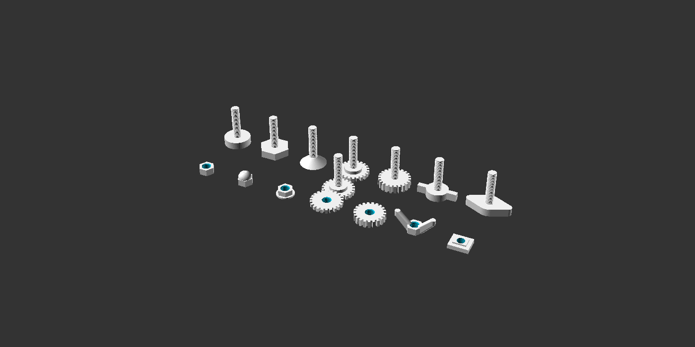

# Metric Fastener Workbench

Parametric OpenSCAD models and a browser customizer for ISO coarse metric sizes **M1, M1.2, M1.4, M1.6, M1.8, M2, M2.5, M3, M3.5, M4, M5, M6, M7, M8, M9 and M10**.



The image shows the actual OpenSCAD geometry. The self-tapping screw prints head-down: its full-diameter root joins the head and its tapered point rises at the far end of the shank.

## Web app

Live customizer: <https://tumesh007.github.io/metric-fastener-workbench/>  
[Download the Mac app package](Metric-Fastener-Workbench-Mac.zip)

The GitHub Pages web app generates and downloads both parametric `.scad` files and watertight binary `.stl` files directly in the browser for all parts (bolts, nuts, self-tapping screws, printed inserts, wall plugs, and batch plates). No backend or local OpenSCAD install is required for direct STL export on GitHub Pages. For offline OpenSCAD rendering or local batch jobs, the included `server.mjs` service supports direct rendering of all fastener parts.

## Part options (FreeCAD Fasteners Workbench taxonomy)

Standardized parametric models mapped to official ISO / DIN / EN standards:

- **Hexagon head bolts & screws:** ISO 4014 / ISO 4017 / DIN 933 (standard hex), EN 1665 / ISO 4162 (flanged hex). Cap face down at Z=0 for support-free 3D printing.
- **Hexagon socket & countersunk screws:** ISO 4762 (socket head cap), ISO 7380 (button head), ISO 10642 (90° countersunk flat head).
- **Pan & thumb screws:** ISO 7045 (pan head), DIN 464 (knurled thumb screw).
- **Drives:** Hex socket (Allen key), Torx / Hexalobular (ISO 14579), Phillips cross-recess, Slotted (ISO 1207), and solid / none.
- **Nuts:** ISO 4032 / DIN 934 (standard hex), DIN 6923 / ISO 4161 (flanged nut), DIN 985 (prevailing torque lock / Nyloc), DIN 1587 (acorn dome cap nut), DIN 315 (wing nut).
- **Washers:** ISO 7089 / DIN 125 (standard flat washer), ISO 7093 / DIN 9021 (fender / large OD penny washer).
- **Rods & studs:** DIN 975 continuous threaded metric rod / stud.
- **Set screws:** ISO 4026 / DIN 913 headless grub screw with internal socket.
- **T-slot fasteners:** Drop-in / hammer nut for 2020 (6 mm slot) and 3030 (8 mm slot) aluminum extrusion profiles.
- **Wood / self-tapping screws:** DIN 571 tapered pointed screw geometry.
- **Inserts & anchors:** Knurled heat-set insert mock-up and tapered split expansion wall plug.

Open `metric_fastener.scad` in OpenSCAD and use the Customizer panel, or open `index.html` for the browser controls. The browser drawing is illustrative; the OpenSCAD-rendered image above shows the generated geometry.


## 0.4 mm Nozzle Printability & Slicer Settings

### Can a 0.4 mm nozzle print it?
- **M3 to M10 (Recommended):** Yes. Standard 0.4 mm nozzle prints these reliably with functional, mating threads.
- **M2 and M2.5 (Borderline):** Possible with tuned slicing (0.08–0.12 mm layer height, Arachne engine, 25 mm/s outer wall speed). Crests round slightly; best for light retention or self-tapping.
- **M1 to M1.8 (Not supported on 0.4 mm):** Coarse pitches (0.25–0.35 mm) and minor diameters are narrower than standard 0.42 mm extrusion lines. Threads fuse into solid cylinders. Requires a 0.2 mm nozzle or MSLA/resin printer.

### Recommended Bambu Studio / Slicer Profile (Bambu Lab A1 Mini / Gold PEI)
| Setting | Recommended Value | Why |
|---|---|---|
| **Layer Height** | `0.12 mm` (Optimal) or `0.08 mm` (High detail M2–M3) | Captures 60° thread flank overhangs cleanly |
| **Wall Generator** | **Arachne** | Adapts extrusion line width along tapering thread crests |
| **Wall Loops** | `5` to `6` (100% solid walls) | Fastener shanks need maximum shear strength; avoid sparse infill |
| **Infill** | `100% Rectilinear` | Eliminates internal voids under torque |
| **Outer Wall Speed** | `25–35 mm/s` | Slow speed prevents thread rounding and corner bulging |
| **Seam Position** | **Random** | Prevents aligned vertical seam bump from binding nut threads |
| **Print Orientation** | Cap-face down (Z = 0) | Pre-oriented in models. Bed contact on cap face, zero supports |
| **Thread Clearance** | `0.20 mm` radial (`0.40 mm` diametral) | Increase to `0.25–0.30 mm` for PETG or tight printers |
| **Part Cooling** | 100% fan, min layer time 4–6 s | Prevents heat accumulation on small bolt tips |

---

## Local Webserver & Network IP

- **Web App URL (GitHub Pages):** <https://tumesh007.github.io/metric-fastener-workbench/> (Zero install, direct STL export in browser).
- **Local Webserver URL (Loopback):** `http://127.0.0.1:4173` or `http://localhost:4173`
- **Local Network / LAN IP:** `http://<your-ip>:4173` (binds to `0.0.0.0:4173`).
- **Start Local Server:**
  ```bash
  node server.mjs
  ```
  Or double-click `Metric Fastener Workbench.app` on macOS.

## Print and fit notes

- Thread pitch values use the ISO coarse series (ISO 261); the swept thread form is an approximation for FDM printing, not a certified thread profile. See [ISO 261 coarse pitch table](https://cdn.standards.iteh.ai/samples/4165/ec50482690954e82931c52fdce3bc8bb/ISO-261-1998.pdf) and [ISO 724 basic dimensions](https://standards.iteh.ai/catalog/standards/iso/e95db92c-4080-4105-9dd6-5d42b9923765/iso-724).
- Default thread clearance is **0.20 mm radially** (0.40 mm diametral). Tune for printer, material and slicer; print a short fit sample first.
- Plastic bolts and nuts are prototypes for light-duty use, not strength-rated metal replacements. The new self-tapping screws, printed insert mock-ups and wall plugs are experimental geometry, not certified hardware or anchors.

## Troubleshooting and export limits

See the [diagnostic report](docs/WORKBENCH_DIAGNOSTIC_REPORT.md) for the self-tapping screw orientation history, STL export workflow, verified limits on GitHub Pages, and the recommended selected-part STL feature.
